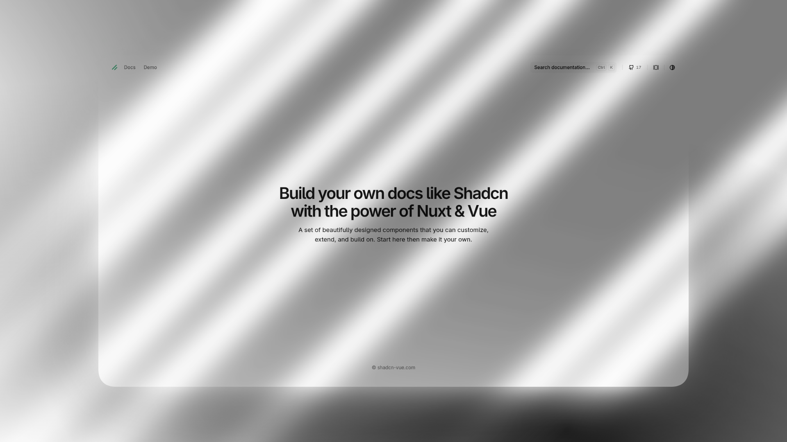
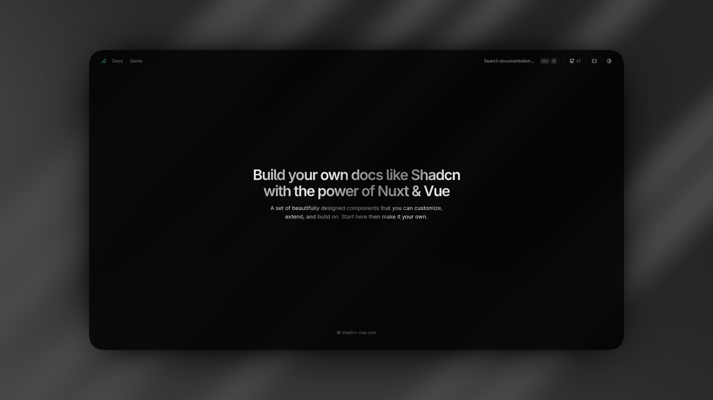

# shadcn-docs-template

### Enjoying my project? Please show your appreciation by starring it on GitHub! ⭐

A production-ready documentation template built with **Nuxt 4.7** and **shadcn-vue**. Engineered for speed, clarity, and developer sanity.


<br />


## 📚 Documentation
For more information, please visit the [Documentation](https://shadcn-docs-template-hwnwf5.cranl.net).

## ✨ Features

- **Nuxt 4.7 & Nuxt Content 3**: Modern, file-based content management with full SSR, SSG, and ISR support.
- **Shadcn Vue & Reka UI**: Accessible, customizable components styled with Tailwind CSS v4.
- **Tailwind CSS 4**: Next-generation CSS engine with high performance and zero-config CSS variables.
- **MDC Components**: Rich Markdown support with custom components like `Callout`, `ComponentPreview`, and more.
- **Dark Mode**: Seamless light and dark mode powered by `@nuxtjs/color-mode`.
- **Integrated Search**: Fast, client & server-side documentation search.
- **Dynamic OG Images**: Automated social sharing cards via `nuxt-og-image` and Satori.
- **Syntax Highlighting**: Beautiful code blocks powered by Shiki.
- **Performance & SEO**: Built-in font and image optimization with `@nuxt/fonts` and `@nuxt/image`.

## 🛠️ Tech Stack

- [Nuxt 4](https://nuxt.com)
- [Vue 3](https://vuejs.org)
- [Nuxt Content v3](https://content.nuxt.com)
- [Tailwind CSS v4](https://tailwindcss.com)
- [Shadcn Vue](https://www.shadcn-vue.com) / [Reka UI](https://reka-ui.com)
- [Lucide Vue](https://lucide.dev)
- [Shiki](https://shiki.style)
- [GSAP](https://gsap.com)

## 🚀 Getting Started

### Installation

1. Clone the repository:
   ```bash
   git clone https://github.com/hetari/shadcn-docs-template.git
   cd shadcn-docs-template
   ```

2. Install dependencies:
   ```bash
   bun install
   ```

### Development

Start the development server:

```bash
bun dev
```

The site will be available at `http://localhost:3000`.

### Building & Preview

```bash
# Build for production
bun run build

# Preview production build
bun run preview
```

### Upgrade

To upgrade Nuxt to the latest version:
```bash
bunx --bun nuxt@latest upgrade
```

To update all project dependencies:
```bash
bun update
```
